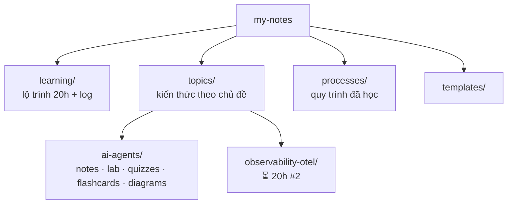

# 📚 my-notes

Kho kiến thức cá nhân: **công nghệ** + **quy trình** đã học, tổ chức theo chủ đề, học theo phương pháp 20 giờ (Josh Kaufman, *The First 20 Hours*).

> **Đang học:** 🤖 AI Agents (20h #1): [lộ trình + log](learning/ai-agents-20h.md) · **Buổi kế** ghi ở dòng đầu file đó.

## Bản đồ repo

| Thư mục | Chứa gì | Khi nào thêm vào |
|---|---|---|
| [`learning/`](learning/) | Lộ trình 20h của từng chủ đề, log từng buổi, retro | Mỗi khi bắt đầu/kết thúc một buổi học |
| [`topics/<chủ-đề>/`](topics/) | `notes/` khái niệm · `lab/` code chạy được · `quizzes/` bài test theo chặng · `flashcards.md` · `diagrams/` | Học xong một khái niệm, có một bài lab mới |
| [`processes/`](processes/) | Quy trình (incident, postmortem, release, on-call…) dạng **template/public** | Học được một quy trình đáng tái sử dụng |
| [`templates/`](templates/) | Khung cho note / process | Copy khi tạo file mới |

## Chủ đề

| Chủ đề | Trạng thái | Vào học |
|---|---|---|
| 🤖 [AI Agents](topics/ai-agents/) | 🟢 Đang học (0/20h) | [learning/ai-agents-20h.md](learning/ai-agents-20h.md) |
| 📡 [Observability — OpenTelemetry](topics/observability-otel/) | ⏳ Chờ (20h #2) | — |

## Quy tắc của repo

1. **Một chủ đề 20h tại một thời điểm.** Chủ đề mới vào hàng đợi trong [learning/README](learning/README.md).
2. **Chỉ ghi điều đã kiểm chứng** từ docs chính thức (có link và ngày kiểm). Điều chưa kiểm thì gắn ⚠️ *chưa kiểm chứng*.
3. **Không dữ liệu nội bộ công ty** (runbook, log, alert, email, schema thật). Chỉ dùng dữ liệu public hoặc tự tạo.
4. **Mỗi buổi để repo ở trạng thái chạy được** (`pytest` xanh) và cập nhật dòng "Buổi kế".
5. Sơ đồ: Mermaid ngay trong markdown (GitHub render được). Sơ đồ tương tác thì dùng [Archify](https://github.com/tt-a1i/archify), lưu HTML trong `diagrams/` kèm file JSON nguồn.

## Học tiếp với Claude

Mở session mới trong repo này rồi gõ: **"học tiếp"** (hoặc "buổi N"). Claude đọc [CLAUDE.md](CLAUDE.md), tìm dòng "Buổi kế" rồi vào bài ngay.
