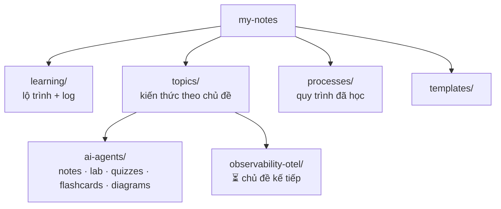

# 📚 my-notes

Kho kiến thức cá nhân: **công nghệ** + **quy trình** đã học, tổ chức theo chủ đề, học theo phương pháp 20 giờ (Josh Kaufman, *The First 20 Hours*).

> **Đang học:** 🤖 AI Agents (40h: 20h agent nền tảng + 20h Retrieval & Memory): [lộ trình + log](learning/ai-agents-40h.md) · **Buổi kế** ghi ở dòng đầu file đó.

## Bản đồ repo



| Thư mục | Chứa gì | Khi nào thêm vào |
|---|---|---|
| [`learning/`](learning/) | Lộ trình (khối 20h) của từng chủ đề, log từng buổi, retro | Mỗi khi bắt đầu/kết thúc một buổi học |
| [`topics/<chủ-đề>/`](topics/) | `notes/` khái niệm · `lab/` code chạy được · `quizzes/` bài test theo chặng · `flashcards.md` · `diagrams/` | Học xong một khái niệm, có một bài lab mới |
| [`processes/`](processes/) | Quy trình (incident, postmortem, release, on-call…) dạng **template/public** | Học được một quy trình đáng tái sử dụng |
| [`templates/`](templates/) | Khung cho note / process | Copy khi tạo file mới |

## Chủ đề

| Chủ đề | Trạng thái | Vào học |
|---|---|---|
| 🤖 [AI Agents](topics/ai-agents/) | 🟢 Đang học `░░░░░░░░░░ 0/40h` | [learning/ai-agents-40h.md](learning/ai-agents-40h.md) |
| 📡 [Observability — OpenTelemetry](topics/observability-otel/) | ⏳ Chờ (sau AI Agents) | — |

## Quy tắc của repo

1. **Một chủ đề tại một thời điểm** (mỗi chủ đề là 1 hoặc nhiều khối 20h). Chủ đề mới vào hàng đợi trong [learning/README](learning/README.md).
2. **Chỉ ghi điều đã kiểm chứng** từ docs chính thức (có link và ngày kiểm). Điều chưa kiểm thì gắn ⚠️ *chưa kiểm chứng*.
3. **Không dữ liệu nội bộ công ty** (runbook, log, alert, email, schema thật). Chỉ dùng dữ liệu public hoặc tự tạo.
4. **Mỗi buổi để repo ở trạng thái chạy được** (`pytest -q` xanh) và cập nhật dòng "Buổi kế". Được để lại đúng **1 test đỏ có chủ đích** gắn `@pytest.mark.next` cho bước đầu tiên của buổi sau; `pytest -q` mặc định bỏ qua test đó.
5. Sơ đồ: Mermaid ngay trong markdown (GitHub render được). Sơ đồ tương tác thì dùng [Archify](https://github.com/tt-a1i/archify), lưu HTML trong `diagrams/` kèm file JSON nguồn.

## Học tiếp

**Lệnh `hoc`** đưa anh vào đúng chỗ trong vài giây: `cd` vào lab của chủ đề đang học, bật `.venv`, chạy `pytest -q`, chạy riêng test đỏ `pytest -m next` (việc của hôm nay), rồi in dòng "Buổi kế", "Bước tiếp theo" và thanh tiến độ. Cài 1 lần vào `~/.zshrc` hoặc `~/.bashrc`:

```sh
hoc() { cd ~/path/to/my-notes && source scripts/hoc.sh "$@"; }
```

Dùng `source` để shell của anh giữ được `cd` và venv. Gõ `hoc` cho chủ đề 🟢, hoặc `hoc <topic>`.

Rồi mở Claude ngay trong thư mục đó và gõ **"học tiếp"** (hoặc "buổi N"). Claude đọc [CLAUDE.md](CLAUDE.md), tìm dòng "Buổi kế" rồi vào bài ngay. Chỉ có 10–15 phút thì vẫn làm: phiên mini cũng tính giờ.

Tiến độ đo bằng **giờ tích luỹ** (`python3 scripts/progress.py`), không đếm chuỗi ngày liên tục.
