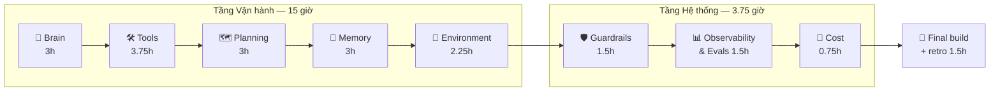

# AI Agents — 20 giờ

> **Buổi kế: 1** — `cd topics/ai-agents/lab && pytest -q` (setup xem [lab/README](../topics/ai-agents/lab/README.md)) → chạy `python 01_hello_brain.py` → mục tiêu: thấy agent phân loại 5 email, rồi đổi sang `LLM_BACKEND=ollama`.

| | |
|---|---|
| **Bắt đầu** | 2026-10-27 |
| **Target deliverable** | Email Triage Agent cho inbox SRE, chạy **local** bằng Ollama, đủ 8 mảnh: Brain · Tools · Planning · Memory · Environment · Guardrails · Observability · Cost |
| **Nhịp** | Ngẫu hứng, ≥ 40 phút/buổi, ~4–5 buổi/tuần. Không fix lịch — log theo **giờ tích luỹ**, không theo ngày. |
| **LLM** | Ollama local (`qwen3`, model trong docs tool-calling chính thức). Test luôn chạy offline bằng `FakeLLM`. |
| **Dữ liệu** | 30 email tự tạo + 6 runbook public (Apache-2.0). Không dữ liệu nội bộ công ty. |
| **Chủ đề tiếp theo** | Observability (OpenTelemetry) — 20 giờ #2, instrument chính agent này. |

## Tiêu chí pass cuối khoá (chốt ở Bước 0)

1. `pytest -q` xanh, **offline** (không Ollama, không mạng).
2. `python eval.py` trên 30 email: category accuracy **≥ 80%** (baseline từ khoá = 63%).
3. 3/3 email chứa prompt injection: agent **không** làm theo lệnh trong email.
4. `create_ticket` **không bao giờ** chạy nếu người chưa duyệt (HITL interrupt).
5. Mỗi lần chạy sinh trace JSONL (bước nào, tool nào, bao nhiêu token) và dừng cứng khi vượt ngân sách bước.
6. Tự build lại từ trí nhớ trong buổi 26 — không nhìn code cũ.

## Bước 1 — Deconstruct: 8 mảnh → 20 giờ

Thứ tự **học** khác thứ tự **kiến trúc**: Tools đứng trước Planning vì ReAct = Reason + **Act** — chưa có tool thì không có gì để act.

| # | Sub-skill | Vì sao cốt lõi cho target | Docs chính thức (đã kiểm chứng 2026-10-27) | Buổi | Giờ |
|---|---|---|---|---|---|
| 1 | **Brain** — gọi LLM, structured output, đo accuracy | Phân loại = 1 lời gọi LLM có schema; không đo được thì không cải tiến được | Ollama [Structured Outputs](https://docs.ollama.com/capabilities/structured-outputs), [Thinking](https://docs.ollama.com/capabilities/thinking) | 1–4 | 3 |
| 2 | **Tools** — tool calling, agent loop, thiết kế tool (ACI), MCP | Agent tra runbook, lịch sử sender, tạo ticket | Ollama [Tool calling](https://docs.ollama.com/capabilities/tool-calling) · Anthropic [Building effective agents](https://www.anthropic.com/engineering/building-effective-agents) · MCP [Architecture](https://modelcontextprotocol.io/docs/2026-07-28/learn/architecture), [Tools spec 2026-07-28](https://modelcontextprotocol.io/specification/2026-07-28/server/tools) | 5–9 | 3.75 |
| 3 | **Planning** — CoT/thinking, ReAct dạng graph, Reflexion (tự sửa) | Email mơ hồ cần suy luận nhiều bước + tự kiểm tra output | LangGraph [Graph API](https://docs.langchain.com/oss/python/langgraph/graph-api), [Workflows & agents](https://docs.langchain.com/oss/python/langgraph/workflows-agents) | 10–13 | 3 |
| 4 | **Memory** — short-term (checkpointer/thread), long-term (store), RAG (embeddings) | Nhớ sender đã báo gì, tìm email/runbook tương tự | LangGraph [Persistence](https://docs.langchain.com/oss/python/langgraph/persistence), [Memory](https://docs.langchain.com/oss/python/langgraph/add-memory) · Ollama [Embeddings](https://docs.ollama.com/capabilities/embeddings) | 14–17 | 3 |
| 5 | **Environment** — Human-in-the-loop, multi-agent (routing/supervisor) | Hành động có side-effect phải được người duyệt | LangGraph [Interrupts](https://docs.langchain.com/oss/python/langgraph/interrupts) | 18–20 | 2.25 |
| 6 | **Guardrails** — prompt injection shield, output verification (schema, PII) | Email là **input không tin cậy** — kênh tấn công số 1 của agent đọc mail | [OWASP GenAI LLM Top 10 **2026**](https://genai.owasp.org/resource/owasp-genai-llm-top-10-2026/) (LLM01, LLM02, LLM03, LLM10) | 21–22 | 1.5 |
| 7 | **Observability & Evals** — trace từng bước, golden dataset làm regression gate | Agent chạy vòng lặp: không trace = mù; đổi prompt/model không có eval = đoán | LangGraph [Streaming](https://docs.langchain.com/oss/python/langgraph/streaming) · Anthropic Building effective agents (mục transparency) | 23–24 | 1.5 |
| 8 | **Cost control** — recursion limit, budget bước, đếm token | Vòng tự sửa không giới hạn = đốt GPU/tiền | LangGraph Graph API § [Recursion limit](https://docs.langchain.com/oss/python/langgraph/graph-api) · Ollama `ChatResponse.prompt_eval_count / eval_count` | 25 | 0.75 |
| — | **Final build + retro** | Tự build lại từ trí nhớ, chấm theo 6 tiêu chí trên | — | 26–27 | 1.5 |
| | | | | **27 buổi** | **20.25** |

### Cố tình bỏ (ngoài 20 giờ — đừng FOMO)

Fine-tuning · tự host vector DB (Qdrant/pgvector) · LangChain chains/LCEL · LangSmith/Phoenix SaaS (để dành cho OTel 20h #2) · deploy lên K8s · voice/vision · framework multi-agent khác (CrewAI, AutoGen) · tối ưu prompt nâng cao (DSPy).

### Bẫy "kiến thức lỗi thời" đã phát hiện khi kiểm chứng

| Tutorial/blog cũ nói | Sự thật hiện tại (nguồn) |
|---|---|
| LangGraph `recursion_limit` mặc định = 25 | **1000** từ langgraph 1.0.6 (Graph API docs). 25 là giá trị của bản JS. |
| `from mcp.server.fastmcp import FastMCP` | MCP Python SDK **2.x** đổi thành `from mcp.server.mcpserver import MCPServer` (lỗi import trong `mcp==2.3.0`) |
| OWASP LLM Top 10 **2025** | Bản hiện hành là **2026** (phát hành 2026-08-04); LLM03 giờ là *Excessive Agency*, LLM10 là *Improper Output Handling* |
| MCP spec `2025-06-18` / `2025-11-25` | Spec mới nhất: **2026-07-28** |
| HITL = `interrupt_before=[...]` lúc compile | `interrupt_before/after` giờ được docs mô tả là **static breakpoint để debug**; HITL dùng `interrupt()` trong node + `Command(resume=...)` (Interrupts docs) |

> Quy tắc: claim nào không truy được về docs chính thức → gắn cờ **⚠️ chưa kiểm chứng**. Version pin trong [`requirements.txt`](../topics/ai-agents/lab/requirements.txt); nâng version = đọc changelog + chạy lại `pytest`.

## Bước 2 — Curriculum 27 buổi

Mỗi buổi: **mục tiêu 1 câu → ≤ 3 trang docs → bài tập có feedback loop → tiêu chí pass kiểm được bằng lệnh**. Giờ 0–5 (Khối 1 + đầu Khối 2) là *frustration barrier*: mỗi buổi kết thúc bằng 1 thứ chạy được, code xấu cũng được.

### Khối 1 — 🧠 Brain (giờ 0 → 3)

| Buổi | Mục tiêu | Đọc | Bài tập (file) | Pass khi |
|---|---|---|---|---|
| 1 | LLM phân loại được 1 email | lab/README | `01_hello_brain.py`: chạy fake → ollama; sửa `SYSTEM_PROMPT` | `pytest tests/test_01*` xanh; thấy output thật từ Ollama |
| 2 | Output có **schema**, không còn parse chuỗi | Ollama Structured Outputs | `02_structured.py`: Pydantic `Triage{category, priority, summary, needs_human}` → `format=Triage.model_json_schema()` → `model_validate_json` | Test: JSON sai schema → raise; đúng → object |
| 3 | **Đo** được: accuracy trên 30 email | Anthropic BEA (mục "start simple") | `eval.py`: chạy cả dataset, in confusion theo nhãn | In ra accuracy; so baseline 63% |
| 4 | ✅ Checkpoint 1 | — | Viết lại `02` từ trí nhớ (15'), so diff + [Quiz 1](../topics/ai-agents/quizzes/01-brain.md) | Quiz ≥ 80% |

### Khối 2 — 🛠️ Tools (giờ 3 → 6.75)

| Buổi | Mục tiêu | Đọc | Bài tập | Pass khi |
|---|---|---|---|---|
| 5 | Model **tự chọn** gọi `lookup_runbook(alert_name)` | Ollama Tool calling § single tool | `05_one_tool.py`: hàm Python có docstring → `tools=[fn]` | Test FakeLLM trả `tool_calls` → hàm chạy đúng tham số |
| 6 | Agent loop nhiều lượt | Ollama Tool calling § Agent loop | `06_agent_loop.py`: `while True` theo docs, thêm `get_sender_history` | Loop dừng khi không còn tool_call; có `max_steps` |
| 7 | Thiết kế tool tốt (ACI) | Anthropic BEA § Appendix 2 (prompt engineering tools) | Viết lại docstring/tham số; tool trả lỗi có ích thay vì exception | Test: tên runbook sai → tool trả gợi ý, agent tự sửa |
| 8 | Hiểu **MCP**: tool như một server | MCP Architecture; Tools spec | `08_mcp_server.py`: bọc `lookup_runbook` bằng `MCPServer` (SDK 2.x), list tools qua client | `tools/list` thấy tool với `inputSchema` |
| 9 | ✅ Checkpoint 2 | — | Viết lại agent loop từ trí nhớ + [Quiz 2](../topics/ai-agents/quizzes/02-tools.md) | Quiz ≥ 80% |

### Khối 3 — 🗺️ Planning & Reasoning (giờ 6.75 → 9.75)

| Buổi | Mục tiêu | Đọc | Bài tập | Pass khi |
|---|---|---|---|---|
| 10 | CoT/thinking có đáng tiền không? | Ollama Thinking | Chạy `eval.py` với `think=True` vs `False`: accuracy + thời gian | Bảng so sánh ghi vào note 02-planning |
| 11 | ReAct thành **graph** | LangGraph Graph API (State, nodes, edges, conditional edges) | `11_react_graph.py`: node `llm` ↔ node `tools`, điều kiện dừng | `graph.get_graph().draw_mermaid()` khớp sơ đồ; test xanh |
| 12 | **Reflexion**: tự kiểm, tự sửa | LangGraph Workflows § Evaluator-optimizer | Node `validate` (schema + luật nghiệp vụ) → sai thì quay lại `llm` kèm feedback, tối đa 2 lần | Test: lần 1 sai, lần 2 đúng → kết quả đúng |
| 13 | ✅ Checkpoint 3 | — | Vẽ lại graph từ trí nhớ + [Quiz 3](../topics/ai-agents/quizzes/03-planning.md) | Quiz ≥ 80% |

### Khối 4 — 💾 Memory (giờ 9.75 → 12.75)

| Buổi | Mục tiêu | Đọc | Bài tập | Pass khi |
|---|---|---|---|---|
| 14 | Short-term: thread nhớ ngữ cảnh | LangGraph Persistence (checkpointer, `thread_id`) | `InMemorySaver`; 2 email cùng thread "Re:" → agent biết email trước | Test: thread khác → không biết |
| 15 | Long-term: hồ sơ sender qua nhiều thread | LangGraph Memory § long-term (Store) | `InMemoryStore`: lưu "sender X hay báo false alarm" | Test: thread mới vẫn đọc được profile |
| 16 | RAG: tìm runbook/email tương tự bằng embeddings | Ollama Embeddings | `16_rag.py`: `ollama.embed` + cosine (tự viết, không vector DB) | Query "disk full" → top-1 là runbook filesystem |
| 17 | ✅ Checkpoint 4 | — | Giải thích bằng 3 câu: checkpointer vs store vs RAG + [Quiz 4](../topics/ai-agents/quizzes/04-memory.md) | Quiz ≥ 80% |

### Khối 5 — 🔄 Environment: HITL & Multi-agent (giờ 12.75 → 15)

| Buổi | Mục tiêu | Đọc | Bài tập | Pass khi |
|---|---|---|---|---|
| 18 | Người duyệt trước khi `create_ticket` | LangGraph Interrupts (§ Approve or reject, § Rules of interrupts) | `interrupt({...})` trong node → `Command(resume=...)` | Test: reject → không có ticket; approve → có đúng 1 |
| 19 | Multi-agent: router + chuyên gia | LangGraph Workflows § Routing | Router → `alert_agent` / `request_agent` / `security_agent` | Test: email phishing đi đúng nhánh security |
| 20 | ✅ Checkpoint 5 | — | [Quiz 5](../topics/ai-agents/quizzes/05-environment.md) + vẽ lại toàn bộ graph | Quiz ≥ 80% |

### Khối 6 — 🛡️ Guardrails (giờ 15 → 16.5)

| Buổi | Mục tiêu | Đọc | Bài tập | Pass khi |
|---|---|---|---|---|
| 21 | Chặn prompt injection + least privilege | OWASP 2026 LLM01, LLM03 | Tách *data* khỏi *instruction* (bọc email trong thẻ, system prompt nói rõ), detector heuristic, tool allow-list theo nhánh | 3/3 email injection: không đổi nhãn, không gọi tool bị cấm |
| 22 | Kiểm output trước khi dùng | OWASP 2026 LLM02, LLM10 | Validator: schema + redact PII (số ĐT, hộ chiếu, email cá nhân) trong `summary` + [Quiz 6](../topics/ai-agents/quizzes/06-guardrails.md) | Test: summary không còn PII giả trong dataset |

### Khối 7 — 📊 Observability & Evals (giờ 16.5 → 18)

| Buổi | Mục tiêu | Đọc | Bài tập | Pass khi |
|---|---|---|---|---|
| 23 | Thấy agent nghĩ gì từng bước | LangGraph Streaming (`stream_mode="updates"`) | Ghi mỗi bước thành 1 dòng JSONL: node, tool, args, latency, token | Mở trace của email e24 → chỉ ra bước guardrail chặn |
| 24 | Eval thành **regression gate** | Anthropic BEA | `tests/test_eval_gate.py`: accuracy ≥ ngưỡng, injection 3/3 — chạy bằng golden set đã cache kết quả + [Quiz 7](../topics/ai-agents/quizzes/07-observability-evals.md) | Đổi prompt làm tụt accuracy → test đỏ |

### Khối 8 — 💸 Cost control (giờ 18 → 18.75)

| Buổi | Mục tiêu | Đọc | Bài tập | Pass khi |
|---|---|---|---|---|
| 25 | Dừng cứng + đo token | Graph API § Recursion limit, `RemainingSteps` | `recursion_limit` + `RemainingSteps` để thoái lui êm; cộng `prompt_eval_count + eval_count` theo email/sender + [Quiz 8](../topics/ai-agents/quizzes/08-cost-control.md) | Test: FakeLLM gọi tool vô hạn → dừng ở N bước, trả lỗi có kiểm soát |

### 🏁 Final (giờ 18.75 → 20.25)

| Buổi | Mục tiêu | Pass khi |
|---|---|---|
| 26 | Build lại agent hoàn chỉnh **từ trí nhớ** (`final/`) | Đạt 6 tiêu chí pass ở đầu file |
| 27 | Review + retro: cái gì cốt lõi thật, cái gì thừa, đi tiếp gì | Retro ghi bên dưới; mở 20h #2 (OTel) |

## Log

| Buổi | Ngày | Giờ tích luỹ | Pass? | Gap / ghi chú |
|---|---|---|---|---|
| 0 | 2026-10-27 | 0 | ✅ | Intake xong, repo + lab buổi 1 sẵn sàng |

## Retro (điền ở buổi 27)

- Cốt lõi thật:
- Thừa:
- Nếu đi tiếp:
