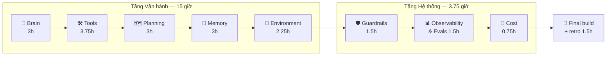
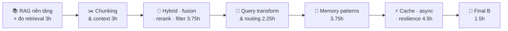

# AI Agents — 40 giờ (thực tế ~42 giờ)

**Phần A (giờ 0 → 20):** agent nền tảng, 8 mảnh. **Phần B (giờ 20 → 40):** Retrieval & Memory chuyên sâu, đưa lên mức production, kết thúc bằng resilience (giờ 20 → 42). Phần B dùng hai khoá làm bản đồ chủ đề, nhưng mọi kiến thức lấy theo docs/chuẩn mới nhất đã đối chiếu:
- *GenAI Retrieval and Memory Patterns* → [references/genai-retrieval-memory-patterns-review.md](../topics/ai-agents/references/genai-retrieval-memory-patterns-review.md)
- *Reliability, SLOs, and Incident Management for GenAI Systems* → [references/genai-reliability-slo-review.md](../topics/ai-agents/references/genai-reliability-slo-review.md).
- *GenAI Model Access Layer and Structured Outputs* → [references/genai-model-access-structured-outputs-review.md](../topics/ai-agents/references/genai-model-access-structured-outputs-review.md). Khoá này bổ sung cho **Phần A** (buổi 2, 3, 7, 10, 12, 21, 23) và buổi 49, 52 mà không tăng giờ; xem bảng "Áp vào lab" trong file review. Phần SLO dashboard / burn-rate alert / postmortem metrics để dành cho chủ đề kế tiếp (Observability & Reliability), vì cần stack Prometheus + Grafana + OTel.

> **Buổi kế: 1** — gõ `hoc` (lần đầu setup theo [lab/README](../topics/ai-agents/lab/README.md)) → chạy `python 01_hello_brain.py` → mục tiêu: thấy agent phân loại 5 email, rồi đổi sang `LLM_BACKEND=ollama`.
>
> **Bước tiếp theo:** làm xanh `pytest -m next`: thêm vào `SYSTEM_PROMPT` một dòng mô tả cho mỗi nhãn.

**Tiến độ:** `░░░░░░░░░░ 0/40h` (giờ tích luỹ, không đếm chuỗi ngày)

| | |
|---|---|
| **Bắt đầu** | 2026-10-27 |
| **Target deliverable** | Email Triage Agent cho inbox SRE, chạy **local** bằng Ollama, đủ 8 mảnh: Brain · Tools · Planning · Memory · Environment · Guardrails · Observability · Cost |
| **Nhịp** | Ngẫu hứng, không fix lịch. **Phiên mini 10–15 phút** (ôn 3 thẻ, làm 1 câu quiz, chạy 1 test, sửa 1 hàm) **vẫn tính** vào giờ tích luỹ; một buổi trong curriculum có thể chia thành nhiều phiên mini. Log theo **giờ tích luỹ**, không theo ngày. Ít mà đều tốt hơn nhiều mà bỏ. |
| **LLM** | Ollama local **`gemma4`** (anh đã có sẵn; có tool calling + structured output theo source/docs Ollama). Đổi model bằng `OLLAMA_MODEL`. Test luôn chạy offline bằng `FakeLLM`. |
| **Dữ liệu** | 30 email tự tạo + 6 runbook public (Apache-2.0) + bộ câu hỏi retrieval tự tạo (`data/retrieval_golden.jsonl`). Không dữ liệu nội bộ công ty. |
| **Stack Phần B** | LlamaIndex (`llama-index-core 0.14.25`) + Ollama (`gemma4`, `embeddinggemma`) + BM25 + Qdrant **local mode** + reranker cross-encoder local. Không gửi dữ liệu ra API ngoài (khoá học dùng OpenAI/Cohere/Qdrant Cloud). |
| **Chủ đề tiếp theo** | Observability (OpenTelemetry), mở sau khi xong 40 giờ này; instrument chính agent này. |

## Tiêu chí pass cuối khoá (chốt ở Bước 0)

1. `pytest -q` xanh, **offline** (không Ollama, không mạng).
2. `python eval.py` trên 30 email: category accuracy **≥ 80%** (baseline từ khoá = 63%).
3. 3/3 email chứa prompt injection: agent **không** làm theo lệnh trong email.
4. `create_ticket` **không bao giờ** chạy nếu người chưa duyệt (HITL interrupt).
5. Mỗi lần chạy sinh trace JSONL (bước nào, tool nào, bao nhiêu token) và dừng cứng khi vượt ngân sách bước.
6. Tự build lại từ trí nhớ trong buổi 26 — không nhìn code cũ.

**Thêm cho Phần B (giờ ~42):**

7. Retrieval eval trên `retrieval_golden.jsonl`: **hit_rate@3 ≥ 0.9** và báo cáo MRR cho từng cấu hình (vector, BM25, hybrid, +rerank, +HyDE); chỉ giữ kỹ thuật nào **cải thiện được số đo**.
8. Context gửi vào LLM luôn nằm trong ngân sách token đã đặt (và context length của Ollama được đặt rõ ràng, không dựa vào mặc định 4k).
9. Retrieval chỉ trả tài liệu người hỏi **được phép xem** (metadata filter theo quyền); test chứng minh không lộ chéo.
10. Memory: phân biệt được episodic / semantic / procedural trong code; ghi memory có lọc PII; procedural memory chỉ đổi khi người duyệt.
11. Cache có key gồm user/tenant + TTL; xử lý được ≥ 10 request đồng thời có giới hạn (`asyncio.Semaphore`) mà không lẫn memory giữa user.
12. Khi model/retrieval lỗi: timeout + retry có giới hạn + circuit breaker hoạt động; retrieval rỗng/điểm thấp ⇒ safe fallback (`needs_human`), không đoán; mọi fallback có cờ `degraded` trong trace.
13. Build lại pipeline RAG + memory + resilience từ trí nhớ ở buổi 55.

## Bước 1 — Deconstruct: 8 mảnh → 20 giờ

Thứ tự **học** khác thứ tự **kiến trúc**: Tools đứng trước Planning vì ReAct = Reason + **Act** — chưa có tool thì không có gì để act.



| # | Sub-skill | Vì sao cốt lõi cho target | Docs chính thức (đã kiểm chứng 2026-10-27) | Buổi | Giờ |
|---|---|---|---|---|---|
| 1 | **Brain** — gọi LLM, structured output, đo accuracy | Phân loại = 1 lời gọi LLM có schema; không đo được thì không cải tiến được | Ollama [Structured Outputs](https://docs.ollama.com/capabilities/structured-outputs), [Thinking](https://docs.ollama.com/capabilities/thinking) | 1–4 | 3 |
| 2 | **Tools** — tool calling, agent loop, thiết kế tool (ACI), MCP | Agent tra runbook, lịch sử sender, tạo ticket | Ollama [Tool calling](https://docs.ollama.com/capabilities/tool-calling) · Anthropic [Building effective agents](https://www.anthropic.com/engineering/building-effective-agents) · MCP [Architecture](https://modelcontextprotocol.io/docs/2026-07-28/learn/architecture), [Tools spec 2026-07-28](https://modelcontextprotocol.io/specification/2026-07-28/server/tools) | 5–9 | 3.75 |
| 3 | **Planning** — CoT/thinking, ReAct dạng graph, Reflexion (tự sửa) | Email mơ hồ cần suy luận nhiều bước + tự kiểm tra output | LangGraph [Graph API](https://docs.langchain.com/oss/python/langgraph/graph-api), [Workflows & agents](https://docs.langchain.com/oss/python/langgraph/workflows-agents) | 10–13 | 3 |
| 4 | **Memory** — short-term (checkpointer/thread), long-term (store), RAG (embeddings) | Nhớ sender đã báo gì, tìm email/runbook tương tự | LangGraph [Persistence](https://docs.langchain.com/oss/python/langgraph/persistence), [Memory](https://docs.langchain.com/oss/python/langgraph/add-memory) · Ollama [Embeddings](https://docs.ollama.com/capabilities/embeddings) | 14–17 | 3 |
| 5 | **Environment** — Human-in-the-loop, multi-agent (routing/supervisor) | Hành động có side-effect phải được người duyệt | LangGraph [Interrupts](https://docs.langchain.com/oss/python/langgraph/interrupts) | 18–20 | 2.25 |
| 6 | **Guardrails** — prompt injection shield, output verification (schema, PII) | Email là **input không tin cậy** — kênh tấn công số 1 của agent đọc mail | [OWASP GenAI LLM Top 10 **2026**](https://genai.owasp.org/resource/owasp-genai-llm-top-10-2026/) (LLM01, LLM02, LLM03, LLM10) | 21–22 | 1.5 |
| 7 | **Observability & Evals** — trace từng bước, golden dataset làm regression gate | Agent chạy vòng lặp: không trace = mù; đổi prompt/model không có eval = đoán | LangGraph [Streaming](https://docs.langchain.com/oss/python/langgraph/streaming) · Anthropic Building effective agents (mục transparency) | 23–24 | 1.5 |
| 8 | **Cost control** — recursion limit, budget bước, đếm token | Vòng tự sửa không giới hạn = đốt GPU/tiền | LangGraph Graph API § [Recursion limit](https://docs.langchain.com/oss/python/langgraph/graph-api) · Ollama `ChatResponse.prompt_eval_count / eval_count` | 25 | 0.75 |
| — | **Final build + retro** | Tự build lại từ trí nhớ, chấm theo 6 tiêu chí trên | — | 26–27 | 1.5 |
| | | | | **27 buổi** | **20.25** |

### Cố tình bỏ (ngoài 20 giờ — đừng FOMO)

Fine-tuning · tự host vector DB (Qdrant/pgvector) · LangChain chains/LCEL · LangSmith/Phoenix SaaS (để dành cho OTel 20h #2) · deploy lên K8s · voice/vision · framework multi-agent khác (CrewAI, AutoGen) · tối ưu prompt nâng cao (DSPy).

### Bẫy "kiến thức lỗi thời" đã phát hiện khi kiểm chứng

| Tutorial/blog cũ nói | Sự thật hiện tại (nguồn) |
|---|---|
| LangGraph `recursion_limit` mặc định = 25 | **1000** từ langgraph 1.0.6 (Graph API docs). 25 là giá trị của bản JS. |
| `from mcp.server.fastmcp import FastMCP` | MCP Python SDK **2.x** đổi thành `from mcp.server.mcpserver import MCPServer` (lỗi import trong `mcp==2.3.0`) |
| OWASP LLM Top 10 **2025** | Bản hiện hành là **2026** (phát hành 2026-08-04); LLM03 giờ là *Excessive Agency*, LLM10 là *Improper Output Handling* |
| MCP spec `2025-06-18` / `2025-11-25` | Spec mới nhất: **2026-07-28** |
| Ollama tự dùng context lớn của model | Máy **< 24 GiB VRAM** mặc định chỉ **4k** context; docs khuyên agent đặt **≥ 64000** (docs/context-length.mdx) |
| LRU = "last recently used" (khoá GenAI Retrieval & Memory) | **Least** Recently Used (docs Python `functools.lru_cache`) |
| "Re-ranking bằng Reciprocal Rank Fusion" | RRF là **fusion** nhiều danh sách xếp hạng, `Σ 1/(k+rank)`, k = 60 trong LlamaIndex; rerank thật dùng cross-encoder/LLM |
| Docs LlamaIndex: "default chunk overlap is 20" | Code 0.14.25: `SentenceSplitter()` và `Settings.chunk_overlap` = **200**; chạy code để biết sự thật |
| `from llama_index.core.evaluation import generate_question_context_pairs` | Không còn trong `llama-index-core 0.14.25` (ImportError); lab tự viết golden set |
| "OpenAI JSON mode ép model trả đúng schema" | JSON mode (`json_object`) chỉ bảo đảm **JSON hợp lệ**; SDK ghi rõ là *"older method"*. Schema thì dùng Structured Outputs (`json_schema` + `strict: true`) |
| Claude: lấy JSON bằng cách **ép gọi tool** (`tool_choice` `any`/`tool`) | Dùng `output_config.format` / `messages.parse()` (`output_format` cũ đã deprecated); forced `tool_choice` trả **400** trên các model Claude mới nhất |
| "Prompt caching" = lưu cặp prompt → response | Prompt caching của nhà cung cấp cache **tiền tố prompt**, model vẫn sinh câu trả lời mới; lưu response là **response cache** của ứng dụng |
| "Batching = gộp nhiều prompt vào một API call" | Batch API là **job bất đồng bộ** (Anthropic: −50%, tối đa 24h, kết quả không theo thứ tự) |
| HITL = `interrupt_before=[...]` lúc compile | `interrupt_before/after` giờ được docs mô tả là **static breakpoint để debug**; HITL dùng `interrupt()` trong node + `Command(resume=...)` (Interrupts docs) |

> Quy tắc: claim nào không truy được về docs chính thức → gắn cờ **⚠️ chưa kiểm chứng**. Version pin trong [`requirements.txt`](../topics/ai-agents/lab/requirements.txt); nâng version = đọc changelog + chạy lại `pytest`.

## Bước 2 — Curriculum 27 buổi

Mỗi buổi: **mục tiêu 1 câu → ≤ 3 trang docs → bài tập có feedback loop → tiêu chí pass kiểm được bằng lệnh**. Giờ 0–5 (Khối 1 + đầu Khối 2) là *frustration barrier*: mỗi buổi kết thúc bằng 1 thứ chạy được, code xấu cũng được.

### Khối 1 — 🧠 Brain (giờ 0 → 3)

| Buổi | Mục tiêu | Đọc | Bài tập (file) | Pass khi |
|---|---|---|---|---|
| 1 | LLM phân loại được 1 email | lab/README | `01_hello_brain.py`: chạy fake → ollama; sửa `SYSTEM_PROMPT` | `pytest tests/test_01*` xanh; thấy output thật từ Ollama |
| 2 | Output có **schema**, không còn parse chuỗi | Ollama Structured Outputs | `02_structured.py`: Pydantic `Triage{category, priority, summary, needs_human}` → `format=Triage.model_json_schema()` → `model_validate_json` | Test: JSON sai schema → raise; đúng → object |
| 3 | **Đo** được: accuracy trên 30 email | Anthropic BEA (mục "start simple") | `eval.py`: chạy cả dataset, in confusion theo nhãn | In ra accuracy; so baseline 63% |
| 4 | ✅ Checkpoint 1 | — | Viết lại `02` từ trí nhớ (15'), so diff + [Quiz 1](../topics/ai-agents/quizzes/01-brain.md) | Quiz ≥ 80% |

### Khối 2 — 🛠️ Tools (giờ 3 → 6.75)

| Buổi | Mục tiêu | Đọc | Bài tập | Pass khi |
|---|---|---|---|---|
| 5 | Model **tự chọn** gọi `lookup_runbook(alert_name)` | Ollama Tool calling § single tool | `05_one_tool.py`: hàm Python có docstring → `tools=[fn]` | Test FakeLLM trả `tool_calls` → hàm chạy đúng tham số |
| 6 | Agent loop nhiều lượt | Ollama Tool calling § Agent loop | `06_agent_loop.py`: `while True` theo docs, thêm `get_sender_history` | Loop dừng khi không còn tool_call; có `max_steps` |
| 7 | Thiết kế tool tốt (ACI) | Anthropic BEA § Appendix 2 (prompt engineering tools) | Viết lại docstring/tham số; tool trả lỗi có ích thay vì exception | Test: tên runbook sai → tool trả gợi ý, agent tự sửa |
| 8 | Hiểu **MCP**: tool như một server | MCP Architecture; Tools spec | `08_mcp_server.py`: bọc `lookup_runbook` bằng `MCPServer` (SDK 2.x), list tools qua client | `tools/list` thấy tool với `inputSchema` |
| 9 | ✅ Checkpoint 2 | — | Viết lại agent loop từ trí nhớ + [Quiz 2](../topics/ai-agents/quizzes/02-tools.md) | Quiz ≥ 80% |

### Khối 3 — 🗺️ Planning & Reasoning (giờ 6.75 → 9.75)

| Buổi | Mục tiêu | Đọc | Bài tập | Pass khi |
|---|---|---|---|---|
| 10 | CoT/thinking có đáng tiền không? | Ollama Thinking | Chạy `eval.py` với `think=True` vs `False`: accuracy + thời gian | Bảng so sánh ghi vào note 02-planning |
| 11 | ReAct thành **graph** | LangGraph Graph API (State, nodes, edges, conditional edges) | `11_react_graph.py`: node `llm` ↔ node `tools`, điều kiện dừng | `graph.get_graph().draw_mermaid()` khớp sơ đồ; test xanh |
| 12 | **Reflexion**: tự kiểm, tự sửa | LangGraph Workflows § Evaluator-optimizer | Node `validate` (schema + luật nghiệp vụ) → sai thì quay lại `llm` kèm feedback, tối đa 2 lần | Test: lần 1 sai, lần 2 đúng → kết quả đúng |
| 13 | ✅ Checkpoint 3 | — | Vẽ lại graph từ trí nhớ + [Quiz 3](../topics/ai-agents/quizzes/03-planning.md) | Quiz ≥ 80% |

### Khối 4 — 💾 Memory (giờ 9.75 → 12.75)

| Buổi | Mục tiêu | Đọc | Bài tập | Pass khi |
|---|---|---|---|---|
| 14 | Short-term: thread nhớ ngữ cảnh | LangGraph Persistence (checkpointer, `thread_id`) | `InMemorySaver`; 2 email cùng thread "Re:" → agent biết email trước | Test: thread khác → không biết |
| 15 | Long-term: hồ sơ sender qua nhiều thread | LangGraph Memory § long-term (Store) | `InMemoryStore`: lưu "sender X hay báo false alarm" | Test: thread mới vẫn đọc được profile |
| 16 | RAG: tìm runbook/email tương tự bằng embeddings | Ollama Embeddings | `16_rag.py`: `ollama.embed` + cosine (tự viết, không vector DB) | Query "disk full" → top-1 là runbook filesystem |
| 17 | ✅ Checkpoint 4 | — | Giải thích bằng 3 câu: checkpointer vs store vs RAG + [Quiz 4](../topics/ai-agents/quizzes/04-memory.md) | Quiz ≥ 80% |

### Khối 5 — 🔄 Environment: HITL & Multi-agent (giờ 12.75 → 15)

| Buổi | Mục tiêu | Đọc | Bài tập | Pass khi |
|---|---|---|---|---|
| 18 | Người duyệt trước khi `create_ticket` | LangGraph Interrupts (§ Approve or reject, § Rules of interrupts) | `interrupt({...})` trong node → `Command(resume=...)` | Test: reject → không có ticket; approve → có đúng 1 |
| 19 | Multi-agent: router + chuyên gia | LangGraph Workflows § Routing | Router → `alert_agent` / `request_agent` / `security_agent` | Test: email phishing đi đúng nhánh security |
| 20 | ✅ Checkpoint 5 | — | [Quiz 5](../topics/ai-agents/quizzes/05-environment.md) + vẽ lại toàn bộ graph | Quiz ≥ 80% |

### Khối 6 — 🛡️ Guardrails (giờ 15 → 16.5)

| Buổi | Mục tiêu | Đọc | Bài tập | Pass khi |
|---|---|---|---|---|
| 21 | Chặn prompt injection + least privilege | OWASP 2026 LLM01, LLM03 | Tách *data* khỏi *instruction* (bọc email trong thẻ, system prompt nói rõ), detector heuristic, tool allow-list theo nhánh | 3/3 email injection: không đổi nhãn, không gọi tool bị cấm |
| 22 | Kiểm output trước khi dùng | OWASP 2026 LLM02, LLM10 | Validator: schema + redact PII (số ĐT, hộ chiếu, email cá nhân) trong `summary` + [Quiz 6](../topics/ai-agents/quizzes/06-guardrails.md) | Test: summary không còn PII giả trong dataset |

### Khối 7 — 📊 Observability & Evals (giờ 16.5 → 18)

| Buổi | Mục tiêu | Đọc | Bài tập | Pass khi |
|---|---|---|---|---|
| 23 | Thấy agent nghĩ gì từng bước | LangGraph Streaming (`stream_mode="updates"`) | Ghi mỗi bước thành 1 dòng JSONL: node, tool, args, latency, token | Mở trace của email e24 → chỉ ra bước guardrail chặn |
| 24 | Eval thành **regression gate** | Anthropic BEA | `tests/test_eval_gate.py`: accuracy ≥ ngưỡng, injection 3/3 — chạy bằng golden set đã cache kết quả + [Quiz 7](../topics/ai-agents/quizzes/07-observability-evals.md) | Đổi prompt làm tụt accuracy → test đỏ |

### Khối 8 — 💸 Cost control (giờ 18 → 18.75)

| Buổi | Mục tiêu | Đọc | Bài tập | Pass khi |
|---|---|---|---|---|
| 25 | Dừng cứng + đo token | Graph API § Recursion limit, `RemainingSteps` | `recursion_limit` + `RemainingSteps` để thoái lui êm; cộng `prompt_eval_count + eval_count` theo email/sender + [Quiz 8](../topics/ai-agents/quizzes/08-cost-control.md) | Test: FakeLLM gọi tool vô hạn → dừng ở N bước, trả lỗi có kiểm soát |

### 🏁 Final (giờ 18.75 → 20.25)

| Buổi | Mục tiêu | Pass khi |
|---|---|---|
| 26 | Build lại agent hoàn chỉnh **từ trí nhớ** (`final/`) | Đạt 6 tiêu chí pass ở đầu file |
| 27 | Review + retro: cái gì cốt lõi thật, cái gì thừa, đi tiếp gì | Retro ghi bên dưới; mở 20h #2 (OTel) |

---

# Phần B — Retrieval & Memory chuyên sâu (giờ 20 → 42)

Mục tiêu: đưa khối Memory/RAG của agent email từ mức "chạy được" (Phần A, buổi 14–16) lên mức **production**: đo được, tối ưu có bằng chứng, an toàn, chịu tải. Mọi kỹ thuật đều theo quy tắc: **đo baseline → áp kỹ thuật → đo lại → giữ hoặc bỏ**.



| # | Sub-skill | Vì sao cần cho target | Docs chính thức (đã kiểm chứng 2026-10-28) | Buổi | Giờ |
|---|---|---|---|---|---|
| 9 | **RAG nền tảng + đo retrieval**: 5 stage Loading → Indexing → Storing → Querying → Evaluation; hit rate, MRR | Không đo retrieval thì mọi tối ưu sau đều là đoán | LlamaIndex *Understanding RAG*, *Starter example (local)*, *Evaluation* (`RetrieverEvaluator`) | 28–31 | 3 |
| 10 | **Chunking & quản lý context**: SentenceSplitter, SemanticSplitter, token budget, truncate/summarize | Chunk sai thì retrieval sai; context vượt cửa sổ thì model "quên" | LlamaIndex *Basic strategies* (chunk sizes), *Node parsers* · Ollama *Context length* | 32–35 | 3 |
| 11 | **Hybrid search, fusion, rerank, metadata filter** | Runbook có tên alert (cần khớp chữ) lẫn mô tả triệu chứng (cần khớp nghĩa); filter theo quyền là bắt buộc | LlamaIndex *Retrievers* (BM25, `QueryFusionRetriever`), *Node postprocessors*, *Metadata filters* | 36–40 | 3.75 |
| 12 | **Query transformation & routing**: rewrite, HyDE, decomposition, adaptive routing | Email người viết mơ hồ, không giống câu chữ trong runbook | LlamaIndex *Query transformations*, *Routers* · HyDE paper | 41–43 | 2.25 |
| 13 | **Memory patterns**: episodic / semantic / procedural, short-term vs long-term, chính sách ghi | Agent nhớ đúng thứ, không nhớ PII, không bị đầu độc | LangChain *Memory concepts* · LangGraph *Memory* (store) · Qdrant local mode | 44–48 | 3.75 |
| 14 | **Cache, async, resilience**: TTL cache theo tenant, semaphore, timeout + retry có jitter + circuit breaker, degradation ladder + safe fallback, idempotency key, health/synthetic probe, SLI theo boundary | Model/GPU bão hoà, retrieval rỗng, tool lỗi: agent phải **xuống cấp an toàn** thay vì đoán bừa hay treo | Python *asyncio* · OTel GenAI semconv (`semantic-conventions-genai`) · K8s probes · SRE Workbook | 49–54 | 4.5 |
| — | **Final B + retro** | Build lại từ trí nhớ, chấm theo tiêu chí 7–13 | — | 55–56 | 1.5 |
| | | | | **29 buổi** | **21.75** |

### Cố tình bỏ ở Phần B

GraphRAG / knowledge graph · fine-tune embedding model · vector DB tự quản lý cluster (Qdrant Cloud, sharding) · LangSmith/Phoenix (để dành cho OTel) · reranker gọi API ngoài (Cohere…) · multimodal RAG · agentic RAG nhiều tầng.

### Cài thêm cho Phần B (một lần, đầu buổi 28)

```bash
pip install -r requirements-partB.txt     # LlamaIndex + Ollama integrations + BM25 + Qdrant local
ollama pull embeddinggemma                # model embedding dùng trong docs Ollama
```

### Khối 9 — 📚 RAG nền tảng + đo retrieval (giờ 20 → 23)

| Buổi | Mục tiêu | Đọc | Bài tập (file) | Pass khi |
|---|---|---|---|---|
| 28 | RAG đầu tiên trên 6 runbook bằng LlamaIndex + Ollama | LlamaIndex *Starter example (local)* | `28_rag_basic.py`: `SimpleDirectoryReader` → `VectorStoreIndex` → `as_query_engine` với `Ollama(gemma4)` + `OllamaEmbedding(embeddinggemma)` | Hỏi "disk /var sắp đầy" → câu trả lời trích đúng runbook filesystem |
| 29 | Nhìn bên trong: Document → Node → embedding → retriever vs query engine | LlamaIndex *Understanding RAG* (5 stage), *Indexing* | In số node, metadata, vector; tách `as_retriever()` khỏi phần sinh câu trả lời | Giải thích được mỗi stage bằng output in ra |
| 30 | Đo retrieval: hit rate, MRR | LlamaIndex *Evaluation* (`RetrieverEvaluator`) | `30_retrieval_eval.py` trên `data/retrieval_golden.jsonl` (12 câu hỏi có sẵn, tự thêm 8) | In bảng hit_rate@3, MRR. **Đây là baseline của Phần B** |
| 31 | ✅ Checkpoint 9 | — | Dựng lại RAG từ trí nhớ + [Quiz 9](../topics/ai-agents/quizzes/09-rag-foundations.md) | Quiz ≥ 80% |

### Khối 10 — ✂️ Chunking & quản lý context (giờ 23 → 26)

| Buổi | Mục tiêu | Đọc | Bài tập | Pass khi |
|---|---|---|---|---|
| 32 | Chunk size/overlap ảnh hưởng retrieval thế nào | LlamaIndex *Basic strategies* § Chunk sizes | Quét `chunk_size ∈ {256, 512, 1024}` × overlap, đo lại bằng buổi 30. **Tự kiểm tra mặc định thật** (docs ghi overlap 20, code là 200) | Bảng số + chọn cấu hình bằng số đo |
| 33 | Semantic chunking | LlamaIndex *Node parsers* (`SemanticSplitterNodeParser`) | So SentenceSplitter vs Semantic (`buffer_size`, `breakpoint_percentile_threshold`) | Kết luận dựa trên hit_rate/MRR, không dựa cảm giác |
| 34 | Ngân sách context | Ollama *Context length* · `prompt_eval_count` | Đặt context length rõ ràng; đếm token context; truncate rồi summarize khi vượt ngân sách | Test: context không bao giờ vượt ngân sách đã đặt |
| 35 | ✅ Checkpoint 10 | — | [Quiz 10](../topics/ai-agents/quizzes/10-chunking-context.md) | Quiz ≥ 80% |

### Khối 11 — 🔀 Hybrid, fusion, rerank, filter (giờ 26 → 29.75)

| Buổi | Mục tiêu | Đọc | Bài tập | Pass khi |
|---|---|---|---|---|
| 36 | Sparse retrieval: BM25 | LlamaIndex *BM25 Retriever* | `BM25Retriever.from_defaults(nodes=..., similarity_top_k=...)`; so với vector trên golden set | Chỉ ra được loại câu hỏi BM25 thắng (tên alert chính xác) |
| 37 | Hybrid + RRF | LlamaIndex *Reciprocal Rerank Fusion* example | **Tự viết RRF 10 dòng** (`Σ 1/(60+rank)`), rồi so với `QueryFusionRetriever(mode="reciprocal_rerank", num_queries=1)` | Hai cách cho cùng thứ tự; hybrid ≥ cả vector lẫn BM25 trên golden set (hoặc giải thích vì sao không) |
| 38 | Lọc và rerank | LlamaIndex *Node postprocessors* | `SimilarityPostprocessor(similarity_cutoff=...)` (lọc) vs `SentenceTransformerRerank` cross-encoder local (sắp xếp lại) | Đo MRR trước/sau rerank; ghi độ trễ thêm |
| 39 | Metadata filter = kiểm soát truy cập | LlamaIndex *Metadata filters* | Gắn `team`/`sensitivity` vào node; `MetadataFilters` theo người hỏi | Test: user team A **không bao giờ** nhận chunk của team B |
| 40 | ✅ Checkpoint 11 | — | [Quiz 11](../topics/ai-agents/quizzes/11-hybrid-rerank.md) | Quiz ≥ 80% |

### Khối 12 — 🔁 Query transformation & routing (giờ 29.75 → 32)

| Buổi | Mục tiêu | Đọc | Bài tập | Pass khi |
|---|---|---|---|---|
| 41 | Rewrite & decomposition | LlamaIndex *Query transformations* | Viết lại email dài thành query tìm kiếm ngắn; tách email nhiều vấn đề thành nhiều sub-query | So hit_rate trước/sau |
| 42 | HyDE và routing | LlamaIndex `HyDEQueryTransform`, *Routers* | HyDE trên golden set; router chọn BM25 (có tên alert) hay vector (mô tả triệu chứng) | Giữ HyDE/router **chỉ khi** số đo tăng; ghi lại trường hợp HyDE làm tệ đi |
| 43 | ✅ Checkpoint 12 | — | [Quiz 12](../topics/ai-agents/quizzes/12-query-transform.md) | Quiz ≥ 80% |

### Khối 13 — 🧠 Memory patterns (giờ 32 → 35.75)

| Buổi | Mục tiêu | Đọc | Bài tập | Pass khi |
|---|---|---|---|---|
| 44 | 3 loại memory trong code | LangChain *Memory concepts* | Map: semantic = profile người gửi; episodic = các lần xử lý trước (few-shot); procedural = system prompt + luật | Giải thích từng loại bằng ví dụ trong lab |
| 45 | Long-term memory có tìm kiếm | LangGraph *Memory* (store semantic search) · Qdrant local mode | Lưu episodic memory vào Qdrant `QdrantClient(path=...)`; tìm "email tương tự đã xử lý" | Email mới lấy được 2 ví dụ tương tự làm few-shot |
| 46 | Chính sách ghi memory | LangChain *Writing memories* (hot path / background) · OWASP LLM02, LLM05 | Ghi ở background sau khi xử lý; lọc PII trước khi ghi; không ghi nội dung từ email nghi injection | Test: e14 (hộ chiếu) và e24 (injection) không để lại dấu vết trong memory |
| 47 | Procedural memory có kiểm soát | LangChain *Procedural memory* | Agent **đề xuất** sửa luật trong prompt từ phản hồi; người duyệt qua `interrupt()` mới áp dụng | Test: không duyệt thì prompt không đổi |
| 48 | ✅ Checkpoint 13 | — | [Quiz 13](../topics/ai-agents/quizzes/13-memory-patterns.md) | Quiz ≥ 80% |

### Khối 14 — ⚡ Cache, async, resilience (giờ 35.75 → 40.25)

| Buổi | Mục tiêu | Đọc | Bài tập | Pass khi |
|---|---|---|---|---|
| 49 | Cache đúng cách | Python `functools.lru_cache` (LRU = **Least** Recently Used); tự viết TTL cache | Cache exact-match cho retrieval; key = (tenant, quyền, query chuẩn hoá, version index/prompt/model); TTL | Test: cùng query khác tenant → **không** hit cache của nhau |
| 50 | Async + giới hạn đồng thời (bulkhead) | Python *asyncio* (`Semaphore`, `gather`, `wait_for`) | 20 email song song; semaphore **riêng** cho model và retrieval; memory tách theo user | Đo tuần tự vs async; GPU bão hoà ở mức nào; không lẫn state giữa user |
| 51 | Timeout, retry, circuit breaker | [Review khoá SLO](../topics/ai-agents/references/genai-reliability-slo-review.md) dòng 9–11 | Timeout theo ngân sách từng boundary; retry chỉ lỗi tạm thời, exponential backoff + jitter, tôn trọng `Retry-After`; breaker CLOSED → OPEN → HALF_OPEN cho Ollama | Test với FakeLLM lỗi liên tục: breaker mở sau N lỗi, request sau bị từ chối ngay, probe thành công thì đóng lại |
| 52 | Degradation ladder + safe fallback + idempotency | Review dòng 12–16 | Bậc xuống cấp: bỏ rerank → thu nhỏ context → bỏ tool → cache → `needs_human`; `topk rỗng` hoặc `score < ngưỡng` ⇒ safe fallback; `create_ticket` có idempotency key (tenant, email_id, action) | Test: retrieval rỗng → không đoán; retry `create_ticket` → chỉ 1 ticket; mọi fallback phát cờ `degraded` |
| 53 | Health check + synthetic probe + SLI theo boundary | Kubernetes *Liveness/Readiness/Startup probes* · OTel GenAI semconv | `/live`, `/ready`, `/probe/deep` (chạy 1 email golden thật, **bỏ qua cache**); SLI: latency P95/P99 theo boundary, `empty_topk_rate`, `degraded_rate`, token/email; tên metric theo OTel GenAI (pin version vì còn Development) | Inject lỗi (Ollama tắt, Qdrant rỗng) → probe báo **đúng boundary + lý do**; live vẫn OK |
| 54 | ✅ Checkpoint 14 | — | [Quiz 14](../topics/ai-agents/quizzes/14-cache-async-resilience.md) | Quiz ≥ 80% |

### 🏁 Final B (giờ 40.25 → 41.75)

| Buổi | Mục tiêu | Pass khi |
|---|---|---|
| 55 | Build lại pipeline RAG + memory + resilience **từ trí nhớ** (`final_b/`) | Đạt tiêu chí 7–13 |
| 56 | Eval toàn phần (Phần A gate + retrieval gate + test bảo mật + chaos nhẹ) + retro + viết quy trình **"Review RAG/agent trước production"** vào `processes/` | Tất cả xanh; retro và process được commit |

## Log

Mỗi dòng Log cần ngày `YYYY-MM-DD`: email hằng ngày dựa vào ngày của dòng cuối để biết anh có đang chững lại không. Phiên mini ghi thành dòng riêng với cột Buổi dạng `N·mini` (vd: `3·mini`), cột Pass để `—`; chỉ dòng có ✅ mới được tính là "đã xong buổi" (email flashcard dựa vào đây để biết gửi thẻ nào).

| Buổi | Ngày | Giờ tích luỹ | Pass? | Gap / ghi chú |
|---|---|---|---|---|
| 0 | 2026-10-27 | 0 | ✅ | Intake xong, repo + lab buổi 1 sẵn sàng |

## Retro (điền ở buổi 27)

- Cốt lõi thật:
- Thừa:
- Nếu đi tiếp:
