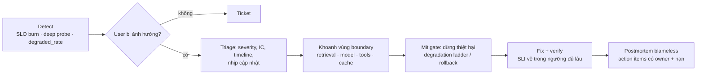

# Incident response cho hệ thống GenAI (RAG / agent)

> **Mục đích:** xử lý sự cố ở hệ thống GenAI, kể cả **lỗi mềm** (HTTP 200 nhưng câu trả lời sai, không có căn cứ, không an toàn).
> **Khi nào dùng:** SLO burn-rate alert, deep probe fail, tỉ lệ `degraded` / `empty_topk` tăng, người dùng báo câu trả lời sai hàng loạt.
> **Nguồn:** Google SRE Book ch.14 *Managing Incidents* · SRE Workbook *Alerting on SLOs* · khoá *Reliability, SLOs, and Incident Management for GenAI Systems* (đã đối chiếu: [review](../topics/ai-agents/references/genai-reliability-slo-review.md)) · kiểm chứng 2026-10-28.
> ⚠️ Đây là template tổng quát. Không ghi tên hệ thống, người hay khách hàng thật vào repo.

## Vai trò (SRE Book)

| Vai trò | Trách nhiệm |
|---|---|
| **Incident Commander** | Nắm toàn cục, phân việc, quyết định; giữ incident doc sống |
| **Operations** | Người **duy nhất** thay đổi hệ thống (rollback, đổi route, tắt tính năng) |
| **Communication** | Cập nhật định kỳ cho stakeholder theo nhịp đã hẹn |
| **Planning** | Theo dõi việc dài hạn, bàn giao ca, ghi lại mọi thay đổi để revert |

## Severity theo tác động người dùng

| Mức | Dấu hiệu GenAI |
|---|---|
| Cao | Chat không dùng được (P99 vượt SLO kéo dài); **câu trả lời sai gây hại / hallucination hàng loạt**; output không an toàn lọt guardrail; nhiều tenant hoặc workflow quan trọng bị ảnh hưởng; **lộ dữ liệu chéo tenant** (retrieval/cache) |
| Thấp | Chất lượng giảm nhẹ nhưng guardrail vẫn chặn được; chi phí tăng bất thường chưa ảnh hưởng người dùng; một dependency chậm nhưng có fallback |

## Các bước

1. **Detect:** xác nhận người dùng thật bị ảnh hưởng (SLO, deep probe, journey chính), đối chiếu deploy hoặc thay đổi config gần nhất.
2. **Triage:** đặt severity, chỉ định IC, mở timeline, hẹn nhịp cập nhật.
3. **Khoanh vùng theo boundary:** metrics (bắt đầu lúc nào, phạm vi) → traces (span nào chậm/lỗi/retry) → logs (lọc theo `trace_id` và cửa sổ thời gian).
4. **Mitigate trước, sửa sau**, theo degradation ladder đã định nghĩa sẵn:
   1. Chặn retry storm: giới hạn số lần thử, kiểm tra breaker đã mở chưa.
   2. Bỏ bước tốn kém, không thiết yếu (rerank, HyDE, tool phụ).
   3. Thu nhỏ context.
   4. Phục vụ cache hợp lệ (đúng tenant, đúng version).
   5. **Safe fallback:** chuyển người xử lý thay vì đoán.
   6. Rollback thay đổi gần nhất nếu thời điểm khớp với lúc chất lượng tụt.
5. **Verify:** latency, chất lượng và chi phí đều về trong ngưỡng **đủ lâu** để loại trừ dao động (không chỉ "service đã lên").
6. **Postmortem blameless:** timeline không ghi tên người; tách nguyên nhân gốc khỏi triệu chứng; đính kèm `trace_id` làm bằng chứng; action item có owner và hạn.

## Checklist riêng cho RAG khi chất lượng tụt mà uptime xanh

- [ ] Vừa đổi **embedding model**? Index cũ không còn tương thích, phải **re-index**.
- [ ] Vừa deploy **index snapshot** mới? Kiểm tra số chunk, dữ liệu thiếu.
- [ ] Ngưỡng `similarity_cutoff` hoặc **metadata filter** vừa bị siết?
- [ ] **Prompt template** sinh query (rewrite/HyDE) vừa đổi?
- [ ] Cache có đang **che** lỗi retrieval không (deep probe phải bỏ qua cache)?
- [ ] Tỉ lệ `empty_topk`, `low_score`, `safe_fallback` thay đổi từ lúc nào?

## Chỉ số sau incident

- Theo dõi **incident lặp lại cùng họ** (repeat incident family): lặp lại nghĩa là fix chưa ship hoặc không hiệu quả.
- Thời gian phục hồi: dùng median/percentile thay vì trung bình (phân phối lệch). Với deploy hỏng, theo DORA hiện tại dùng **failed deployment recovery time** (không còn MTTR), cùng **change fail rate** và **deployment rework rate**.

## Bẫy hay gặp

- Restart hàng loạt khi chưa khoanh vùng: cache bị xoá, kết nối dồn lại, retry tăng vọt, thiệt hại lan rộng hơn.
- Tăng timeout để "hết lỗi": che triệu chứng, hàng đợi phình ra, tail latency tệ hơn.
- Readiness của mọi pod phụ thuộc cùng một model API dùng chung: model lỗi là mọi pod unready, thành outage toàn bộ.
- Coi `degraded=true` là thành công mà không có SLI `degraded_rate` riêng: availability 100% che việc người dùng nhận câu trả lời kém.

## Liên kết

- Chủ đề: `topics/ai-agents/` (Khối 14), `topics/observability-otel/`
