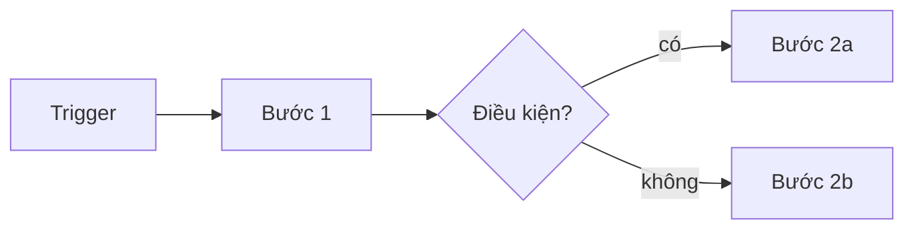

# <Tên quy trình>

> **Mục đích (1 câu):**
> **Khi nào dùng / trigger:**
> **Nguồn:** <link public> · kiểm chứng ngày YYYY-MM-DD

## Vai trò

| Vai trò | Trách nhiệm |
|---|---|

## Các bước

1.
2.

## Checklist

- [ ]

## Bẫy hay gặp

-

## Liên kết

- Chủ đề liên quan: `topics/...`
