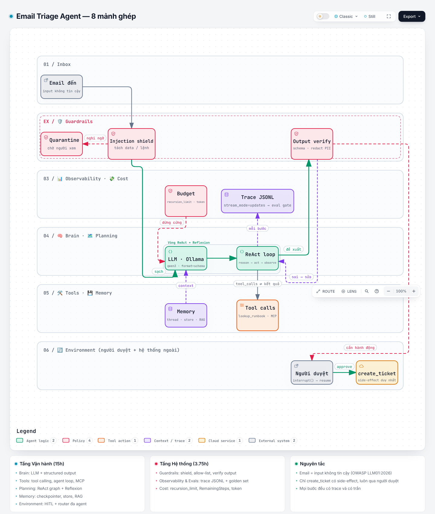
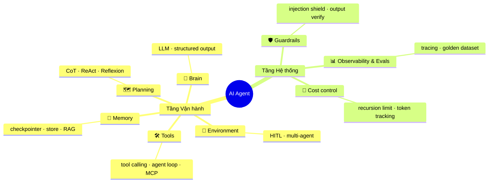

# 🤖 AI Agents

> **Target 20h:** tự build **Email Triage Agent** cho inbox SRE, chạy local bằng Ollama, đủ 8 mảnh ghép.
> Lộ trình + log: [learning/ai-agents-20h.md](../../learning/ai-agents-20h.md)

## Bức tranh tổng thể

Sơ đồ tương tác (trace đường đi, zoom, export, dark mode): tải [`diagrams/email-triage-agent.html`](diagrams/email-triage-agent.html) rồi mở bằng trình duyệt. Nguồn: [`email-triage-agent.json`](diagrams/email-triage-agent.json) (Archify v3.2). Muốn sửa thì sửa JSON rồi chạy lại `finalize`.

## 8 mảnh ghép

| # | Mảnh | Note | Quiz | Buổi | Câu hỏi cốt lõi |
|---|---|---|---|---|---|
| 1 | 🧠 Brain | [note](notes/01-brain.md) | [quiz](quizzes/01-brain.md) | 1–4 | LLM chỉ là hàm `messages → message`. Agent đến từ đâu? |
| 2 | 🛠️ Tools | [note](notes/02-tools.md) | [quiz](quizzes/02-tools.md) | 5–9 | Ai thực sự chạy tool? |
| 3 | 🗺️ Planning | [note](notes/03-planning.md) | [quiz](quizzes/03-planning.md) | 10–13 | Khi nào cần agent, khi nào workflow là đủ? |
| 4 | 💾 Memory | [note](notes/04-memory.md) | [quiz](quizzes/04-memory.md) | 14–17 | Thread state, store và RAG khác nhau thế nào? |
| 5 | 🔄 Environment | [note](notes/05-environment.md) | [quiz](quizzes/05-environment.md) | 18–20 | Hành động nào phải dừng chờ người? |
| 6 | 🛡️ Guardrails | [note](notes/06-guardrails.md) | [quiz](quizzes/06-guardrails.md) | 21–22 | Nếu không chặn injection được 100%, bức tường cuối ở đâu? |
| 7 | 📊 Observability & Evals | [note](notes/07-observability-evals.md) | [quiz](quizzes/07-observability-evals.md) | 23–24 | Làm sao biết đổi model không làm agent tệ đi? |
| 8 | 💸 Cost control | [note](notes/08-cost-control.md) | [quiz](quizzes/08-cost-control.md) | 25 | Trần nào chặn vòng lặp tự sửa đốt GPU cả đêm? |

## Thư mục

| Path | Nội dung |
|---|---|
| [`notes/`](notes/) | 1 file / mảnh: định nghĩa, analogy SRE, cốt lõi **đã kiểm chứng** (kèm nguồn), ghi chú của tôi |
| [`lab/`](lab/) | Mini-project chạy được: `NN_<ten>.py` + `tests/`, `pytest -q` xanh offline |
| [`quizzes/`](quizzes/) | Bài test cuối mỗi chặng (đáp án ẩn) |
| [`flashcards.md`](flashcards.md) | 40 thẻ, gửi 3 thẻ/ngày qua Gmail |
| [`diagrams/`](diagrams/) | Sơ đồ Archify (HTML tương tác + JSON nguồn + PNG preview) |
