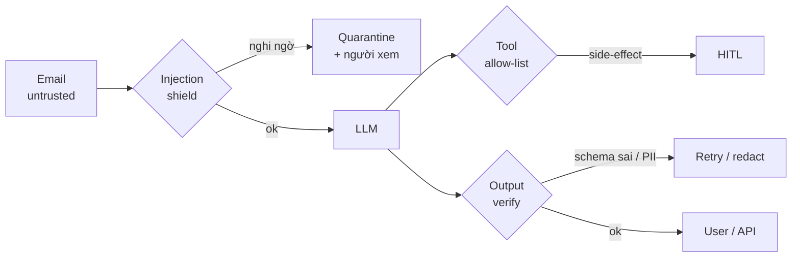

# 6. 🛡️ Guardrails & Alignment — lọc trước và sau khi hành động

> **Một câu:** Với agent đọc email, **mọi nội dung email là input không tin cậy**: guardrail đứng ở 3 chỗ: *trước* LLM (input), *giữa* (quyền tool), *sau* (output).

## Analogy SRE

Như **WAF + RBAC + egress filter** cho một service public: không tin request body, service account chỉ có quyền tối thiểu, response được scrub trước khi ra ngoài.

## Cốt lõi (đã kiểm chứng: OWASP GenAI LLM Top 10 **2026**, phát hành 2026-08-04)

| ID 2026 | Rủi ro | Trong lab |
|---|---|---|
| LLM01 | Prompt Injection | Email e24–e26 cài lệnh "ignore previous instructions…" |
| LLM02 | Sensitive Information Disclosure | Email e08, e14 có SĐT/hộ chiếu giả → redact |
| LLM03 | Excessive Agency | Tool allow-list theo nhánh + HITL |
| LLM06 | Unbounded Consumption | → khối Cost control |
| LLM10 | Improper Output Handling | Validate schema trước khi gọi API |

Nguồn: [genai.owasp.org — LLM Top 10 2026](https://genai.owasp.org/resource/owasp-genai-llm-top-10-2026/), [source GitHub](https://github.com/GenAI-Security-Project/GenAI-LLM-Top10/tree/main/2026/final). ⚠️ Bản **2025** đã archive; thứ tự và tên đã đổi.

- OWASP LLM01:2026, mục *Prevention and Mitigation*: *"LLMs make no architectural distinction between instructions and data, and their behavior is stochastic, so **no reliable prevention mechanism exists today** … Defense is therefore **architectural rather than interceptive**."* Tức là phải thiết kế với giả định chắc chắn sẽ có lúc injection lọt qua, rồi **giới hạn những gì model được phép làm**, để injection thành công cũng không biến thành exploit thành công.
- Email-đọc-bởi-agent chính là **Indirect Prompt Injection** (LLM01 § Types); xem thêm Scenario #7 *Zero-Click Document-Borne Agentic Exfiltration* và #9 *Trusted-Backend Indirect Injection through MCP*.

## Trong lab

Buổi 21 shield + allow-list → 22 output verification.

## Ghi chú của tôi

## Câu hỏi còn mở

-
