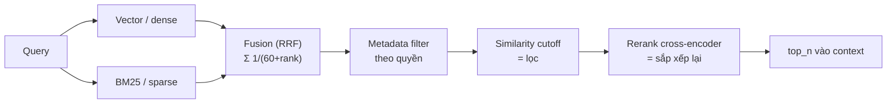

# 11. 🔀 Hybrid search, fusion, rerank, metadata filter

> **Một câu:** Tìm bằng hai cách (chữ + nghĩa), **gộp** hai danh sách (fusion), **lọc** theo quyền và ngưỡng, rồi mới **sắp xếp lại** (rerank) phần còn lại bằng model chính xác hơn.

## Analogy SRE

Như tìm incident: grep đúng tên alert (BM25) + tìm theo triệu chứng (vector), gộp kết quả, bỏ những gì mình không có quyền xem, rồi để chuyên gia xếp lại theo mức liên quan.

## Cốt lõi (đã kiểm chứng)

- **Sparse (BM25)** khớp chữ chính xác, mạnh với tên riêng/mã (vd: `KubePodCrashLooping`). **Dense (vector)** khớp nghĩa. `BM25Retriever.from_defaults(nodes=..., similarity_top_k=...)` (`llama-index-retrievers-bm25 0.8.0`).
- `QueryFusionRetriever(retrievers=[...], mode=..., num_queries=...)`: 4 mode `reciprocal_rerank`, `relative_score`, `dist_based_score`, `simple`.
  - ⚠️ `num_queries` mặc định **4**: retriever gọi LLM sinh thêm `num_queries - 1` câu query. Muốn hybrid thuần, không tốn LLM, thì đặt `num_queries=1`.
- **RRF** (Reciprocal Rank Fusion): `score(d) = Σ 1/(k + rank_i(d))`, LlamaIndex dùng `k = 60` theo bài gốc Cormack et al. (SIGIR 2009). Chỉ dùng **thứ hạng**, không cần điểm hai bên cùng thang.
  - ❌ Khoá học gọi đây là "re-ranking using RRF", và nói fusion để "giảm kích thước". Sai: fusion là **gộp**; giảm kích thước là do top-k.
- **Lọc ≠ rerank**: `SimilarityPostprocessor(similarity_cutoff=x)` bỏ node điểm thấp. `SentenceTransformerRerank` (cross-encoder, local, docs khuyên mặc định `cross-encoder/ms-marco-MiniLM-L6-v2`) chấm lại từng cặp (query, chunk) rồi **đổi thứ tự**. `LLMRerank` chính xác hơn nhưng chậm.
- **Metadata filter**: `MetadataFilters(filters=[MetadataFilter(key, value, operator)])`, toán tử `==, >, <, !=, >=, <=, in, nin`. Với nhiều user/tenant, đây là **kiểm soát truy cập**, không phải tuỳ chọn (OWASP LLM02, LLM08:2026).

## Trong lab

Buổi 36 BM25 → 37 tự viết RRF rồi so với `QueryFusionRetriever` → 38 cutoff vs rerank → 39 filter theo quyền.

## Ghi chú của tôi

## Câu hỏi còn mở

-
