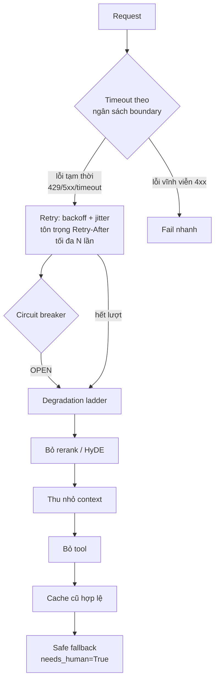

# 14. ⚡ Cache, async, resilience

> **Một câu:** Cache giảm việc lặp lại, async tăng thông lượng; cả hai đều phải **tách theo user/tenant**, nếu không sẽ thành lỗ hổng lộ dữ liệu.

## Analogy SRE

Cache như CDN: hit rate cao thì rẻ và nhanh, nhưng cache key thiếu header `Authorization` là lộ dữ liệu của người khác. Semaphore như connection pool: giới hạn số request đồng thời để không quá tải backend (ở đây là GPU).

## Cốt lõi (đã kiểm chứng)

- **LRU = Least Recently Used**: khi đầy, loại mục **lâu nhất chưa được dùng** (docs Python `functools.lru_cache`: "Least-recently-used cache decorator"). ❌ Khoá học nói "last recently used" là sai.
- **TTL** (time to live): thời gian sống của một mục cache; đặt theo độ "tươi" của nguồn dữ liệu.
- `functools.lru_cache` không có TTL và không an toàn khi tham số chứa dữ liệu nhạy cảm, nên lab tự viết cache nhỏ có TTL.
- **Cache key phải gồm**: tenant/user + phạm vi quyền + query đã chuẩn hoá (+ version của index/prompt). Thiếu thì hai người khác quyền có thể nhận chung một kết quả.
- **Semantic cache** (trả kết quả cũ cho query *gần giống*): rủi ro hit sai khi hai câu gần nghĩa nhưng khác ý. Khoá học không nói rủi ro này. ⚠️ Lab chỉ làm exact-match cache; semantic cache để mở rộng.
- **asyncio**: `asyncio.Semaphore(n)` giới hạn số tác vụ đồng thời; `asyncio.gather` chạy song song nhiều coroutine. LLM local bị giới hạn bởi GPU, nên async tăng thông lượng tới một mức rồi bão hoà; đo, đừng giả định.
- Số liệu "async nhanh gấp đôi / 29 giây" trong khoá học là kết quả demo riêng, không tổng quát.

## Resilience cho agent GenAI (đối chiếu khoá SLO, xem [review](../references/genai-reliability-slo-review.md))

- **Lỗi mềm** là đặc trưng của GenAI: HTTP 200 nhưng câu trả lời sai/không có căn cứ. Phải có SLI chất lượng: `empty_topk_rate`, `low_score_rate`, `degraded_rate`, hit rate golden set.
- **Timeout + retry có giới hạn + backoff có jitter**: chỉ retry lỗi tạm thời (429, 500, 502, 503, 504, timeout), không retry 400. Tôn trọng `Retry-After`.
- **Circuit breaker** cho từng dependency (Ollama, Qdrant): CLOSED → OPEN (từ chối ngay) → HALF_OPEN (cho vài probe) → CLOSED.
- **Bulkhead**: semaphore riêng cho model, retrieval, tool, để một dependency chậm không chiếm hết worker.
- **Safe fallback**: retrieval rỗng hoặc điểm thấp thì **không đoán**; trả `needs_human=True` và phát cờ `degraded`.
- **Idempotency key** cho hành động ghi (`create_ticket`): key = (tenant, email_id, action); retry thì trả kết quả đã lưu.
- **Probe**: `/live` (tiến trình sống), `/ready` (sẵn sàng nhận traffic), `/probe/deep` (chạy email thật, **bỏ qua cache**). ⚠️ Đừng để readiness của mọi pod phụ thuộc một dependency dùng chung: tất cả cùng unready sẽ thành outage toàn bộ.
- **Đặt tên metric** theo OpenTelemetry GenAI semantic conventions (repo `open-telemetry/semantic-conventions-genai`, đang *Development*). ⚠️ `gen_ai.client.token.usage` đang được thay bằng `gen_ai.client.inference.usage.*`, nên pin version.

## Trong lab

Buổi 49 cache có TTL + key theo tenant → 50 async + bulkhead → 51 timeout/retry/breaker → 52 degradation ladder + safe fallback + idempotency → 53 probe + SLI theo boundary.

## Ghi chú của tôi

## Câu hỏi còn mở

-
