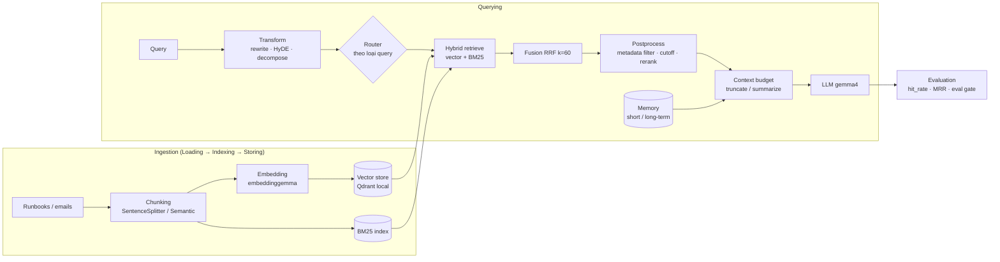

# Kiểm chứng: khoá "GenAI Retrieval and Memory Patterns"

> Tài liệu tham khảo cho **Phần B (giờ 20 → 40)** của lộ trình. Không lưu nguyên transcript trong repo, chỉ lưu kết quả đối chiếu.
> Kiểm chứng ngày **2026-10-28**, trên: docs LlamaIndex (source GitHub `run-llama/llama_index/docs`), code đã cài (`llama-index-core==0.14.25` và các integration bên dưới), docs LangChain/LangGraph (`langchain-ai/docs`), docs Python.

**Kết luận nhanh:** Khoá học đi đúng hướng và đủ rộng: RAG pipeline, chunking, hybrid search, rerank, query transformation, 3 loại memory, cache, async. Dùng làm bản đồ chủ đề được. Nhưng có **3 lỗi khái niệm**, vài chỗ **gộp nhầm thuật ngữ**, và **thiếu hẳn** phần đánh giá retrieval và bảo mật. Lab của mình học theo docs chính thức, không theo code của khoá.

## Bảng đối chiếu

Ký hiệu: ✅ đúng · ⚠️ đúng một phần / cần chỉnh · ❌ sai

| # | Transcript nói | Kết quả | Sự thật & nguồn |
|---|---|---|---|
| 1 | LLM bị giới hạn: kiến thức có ngày cutoff, không có trí nhớ, context window hữu hạn | ✅ | Khớp docs Ollama *context-length*; thêm chi tiết: Ollama mặc định chỉ **4k** context khi VRAM < 24 GiB |
| 2 | "5 stage của RAG": chuẩn bị dữ liệu → xử lý query → retrieval → đưa context vào → sinh câu trả lời | ⚠️ | LlamaIndex định nghĩa 5 stage là **Loading, Indexing, Storing, Querying, Evaluation**. Khoá học **bỏ mất Evaluation**, đúng stage giúp biết tối ưu có hiệu quả không (`docs/framework/understanding/rag/index.mdx`) |
| 3 | Embedding là vector số; hai vector càng gần thì càng giống nghĩa | ✅ | Docs Ollama Embeddings, LlamaIndex Indexing |
| 4 | Quickstart: `SimpleDirectoryReader` → `VectorStoreIndex.from_documents` → `as_query_engine().query()` | ✅ | `starter_example.mdx`. Docs có sẵn bản chạy local bằng Ollama: `starter_example_local.mdx` |
| 5 | `SentenceSplitter` cắt theo kích thước cố định có overlap; `SemanticSplitterNodeParser` cắt theo ngữ nghĩa | ✅ ⚠️ | Đúng về ý. Cơ chế chính xác của SemanticSplitter: gom câu thành nhóm (`buffer_size=1`), tính khoảng cách embedding giữa các nhóm liền kề, cắt ở chỗ khoảng cách vượt **percentile** `breakpoint_percentile_threshold=95`. Không phải "tìm chỗ thuận tiện trước ngưỡng" như khoá học nói |
| 6 | (Khoá không nói) Overlap mặc định | ⚠️ **bẫy docs** | Docs *Basic Strategies* ghi "default chunk overlap is **20**". Nhưng code 0.14.25: `SentenceSplitter()` và `Settings.chunk_overlap` đều là **200**; số 20 chỉ là hằng `DEFAULT_CHUNK_OVERLAP`. Chạy code để biết sự thật |
| 7 | "Dynamic chunk selection": tự điều chỉnh số chunk lấy về theo query | ⚠️ chưa kiểm chứng | Không phải tính năng có tên trong LlamaIndex; là code riêng của khoá. Cái tương đương chính thức: `similarity_top_k` + `SimilarityPostprocessor(similarity_cutoff=...)` |
| 8 | Re-ranking = "sắp xếp lại bằng một language model tinh vi hơn" | ⚠️ | Reranker phổ biến là **cross-encoder** (vd: `SentenceTransformerRerank`, Cohere Rerank), không nhất thiết là LLM. LLM-based rerank (`LLMRerank`) là một lựa chọn chậm hơn. Docs LlamaIndex khuyên mặc định local: `SentenceTransformerRerank` với `cross-encoder/ms-marco-MiniLM-L6-v2` |
| 9 | Hàm `re_rank_by_similarity(..., cutoff)` được gọi là re-rank | ⚠️ | Thực chất là **lọc** theo ngưỡng điểm (tương đương `SimilarityPostprocessor`), không đổi thứ tự bằng model |
| 10 | "Re-ranking using **Reciprocal Rank Fusion**" | ❌ | RRF là **fusion**: gộp nhiều danh sách xếp hạng bằng công thức `score = Σ 1/(k + rank)`, không dùng model. LlamaIndex dùng `k = 60` (đọc từ source `QueryFusionRetriever`). Tên mode `reciprocal_rerank` của LlamaIndex dễ gây nhầm là "rerank" |
| 11 | "Fusion dùng để gộp kết quả **nhằm giảm kích thước** nội dung" | ❌ | Fusion gộp kết quả từ **nhiều query hoặc nhiều retriever** thành một danh sách. Kích thước giảm là nhờ `top_k` sau fusion, không phải mục đích của fusion |
| 12 | Ví dụ query transformation "Provide the precise and factual answer for…" được trình bày trong phần HyDE | ⚠️ | Đó là **query rewriting**. **HyDE** = để LLM viết một *câu trả lời giả định*, rồi **embed câu trả lời đó** để tìm kiếm (Gao et al. 2022, arXiv 2212.10496; `HyDEQueryTransform` + `TransformQueryEngine`). Rủi ro: LLM bịa sai thì tìm nhầm hướng, nên phải đo bằng eval |
| 13 | Keyword search = sparse retrieval (BM25); vector search = dense retrieval; hybrid kết hợp cả hai; top-k | ✅ | `llama-index-retrievers-bm25` (`BM25Retriever.from_defaults(nodes=..., similarity_top_k=...)`), `QueryFusionRetriever(retrievers=[vector, bm25], mode=...)` có 4 mode: `reciprocal_rerank`, `relative_score`, `dist_based_score`, `simple`. Mặc định `num_queries=4`: nó **tự sinh thêm 3 query bằng LLM**. Muốn hybrid thuần thì đặt `num_queries=1` |
| 14 | Metadata filter là bước "optional" | ⚠️ | API đúng (`MetadataFilters`, toán tử `==, >, <, !=, >=, <=, in, nin`). Nhưng với hệ thống nhiều user hoặc nhiều tenant, filter theo quyền truy cập là **bắt buộc**, không phải tuỳ chọn (OWASP LLM02, LLM08:2026) |
| 15 | Episodic = ký ức sự kiện, lưu lịch sử hội thoại trong vector DB; Semantic = kiến thức chung (chuẩn coding, tài liệu kỹ thuật); Procedural = cách làm, qua system prompt | ⚠️ | Docs LangChain (*Memory* concepts, dựa trên paper CoALA): **Semantic** = *facts* (thường là facts về user, quản lý dạng profile hoặc collection). **Episodic** = *experiences*: hành động trước đây của agent, thường dùng làm ví dụ few-shot. **Procedural** = *instructions*: là tổ hợp **model weights + code + prompt**. Docs còn nhắc: semantic memory ≠ semantic search |
| 16 | Redis cho short-term memory, Qdrant cho long-term | ✅ (một lựa chọn thiết kế) | Không phải chuẩn bắt buộc. Trong LangGraph: checkpointer (short-term) + store (long-term). Qdrant có **local mode** chạy không cần server: `QdrantClient(":memory:")` hoặc `path=...` |
| 17 | "LRU means **last** recently used" | ❌ | **Least Recently Used**: loại bỏ mục lâu nhất không được dùng (docs Python `functools.lru_cache`: "Least-recently-used cache decorator"). TTL = time to live ✅ |
| 18 | Cache ngữ nghĩa: query giống nhau thì trả kết quả đã cache | ⚠️ thiếu rủi ro | Khoá học không nói về: (a) query *gần giống* nhưng khác ý dễ trả sai; (b) **cache key phải gồm user/tenant và quyền**, nếu không sẽ lộ dữ liệu chéo người dùng; (c) dữ liệu cũ (TTL theo độ tươi của nguồn) |
| 19 | Async + `asyncio.Semaphore` giới hạn số request đồng thời; tách memory theo user | ✅ | Đúng nguyên tắc. Số liệu "nhanh gấp đôi", "29 giây" là kết quả riêng của demo, không tổng quát |
| 20 | `Production Memory Manager`, `memory_augmented_adaptive_rag`, `hybrid_rag_long_context`, snapshot | ⚠️ | Là **code riêng của khoá học**, không phải API của thư viện nào. Đừng tìm trong docs |
| 21 | Dùng OpenAI, Cohere, Qdrant Cloud, LangSmith | ⚠️ theo quy tắc repo | Đều gửi dữ liệu ra ngoài. Lab thay bằng: Ollama local (`gemma4`, `embeddinggemma`), `SentenceTransformerRerank` local, Qdrant local mode, trace JSONL tự viết |

## Khoá học thiếu gì (lab bổ sung)

1. **Đánh giá retrieval có số đo**: `RetrieverEvaluator` với `hit_rate`, `mrr`, `precision`, `recall`, `ap`, `ndcg` (đọc từ `METRIC_REGISTRY`). Mọi tối ưu (chunk, hybrid, rerank, HyDE) phải chứng minh bằng số, không bằng cảm giác.
2. **Bảo mật cho RAG và memory**: tài liệu truy xuất là *input không tin cậy* (indirect injection, LLM01:2026); kho vector bị đầu độc (LLM09:2026); memory bị ghi nội dung độc hoặc PII (LLM02, LLM05:2026).
3. **Chính sách ghi memory**: ghi gì, khi nào (docs LangChain: *in the hot path* hay *in the background*), ai được sửa procedural memory (phải có HITL).
4. **Bẫy docs lệch code** (dòng 6): luôn chạy thử trên version đã pin.

## Sơ đồ pipeline (theo docs chính thức, có bổ sung)

## Nguồn

- LlamaIndex docs (source): `docs/src/content/docs/framework/understanding/rag/index.mdx`, `getting_started/starter_example*.mdx`, `optimizing/basic_strategies/basic_strategies.md`, `optimizing/advanced_retrieval/query_transformations.md`, `optimizing/rag_failure_mode_checklist.md`, `module_guides/querying/node_postprocessors/node_postprocessors.md`
- Code: `llama-index-core 0.14.25`, `llama-index-retrievers-bm25 0.8.0`, `llama-index-llms-ollama 0.11.0`, `llama-index-embeddings-ollama 0.10.0`, `llama-index-vector-stores-qdrant 0.10.4`, `qdrant-client 1.20.0`
- LangChain docs: `src/oss/concepts/memory.mdx` (Semantic / Episodic / Procedural; writing memories; memory storage)
- HyDE: Gao et al., *Precise Zero-Shot Dense Retrieval without Relevance Labels*, arXiv:2212.10496 (trích trong docstring `HyDEQueryTransform`)
- Python docs: `functools.lru_cache`
